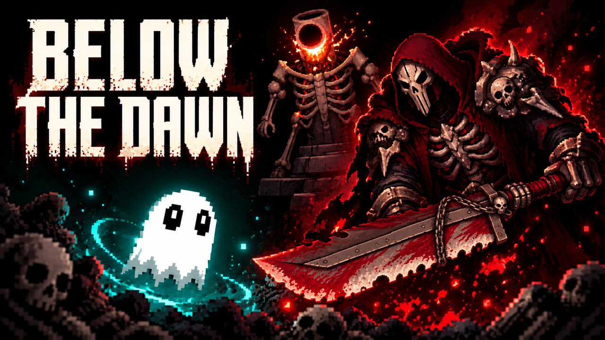
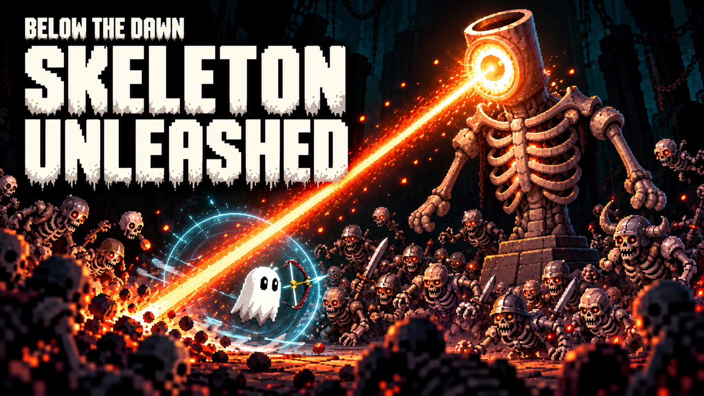
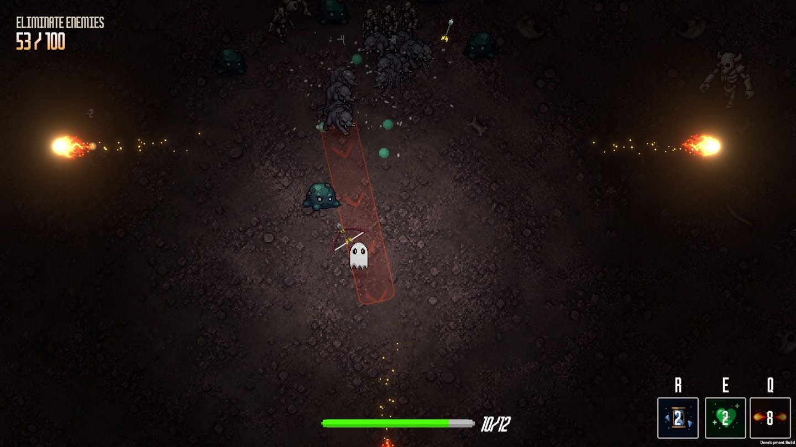
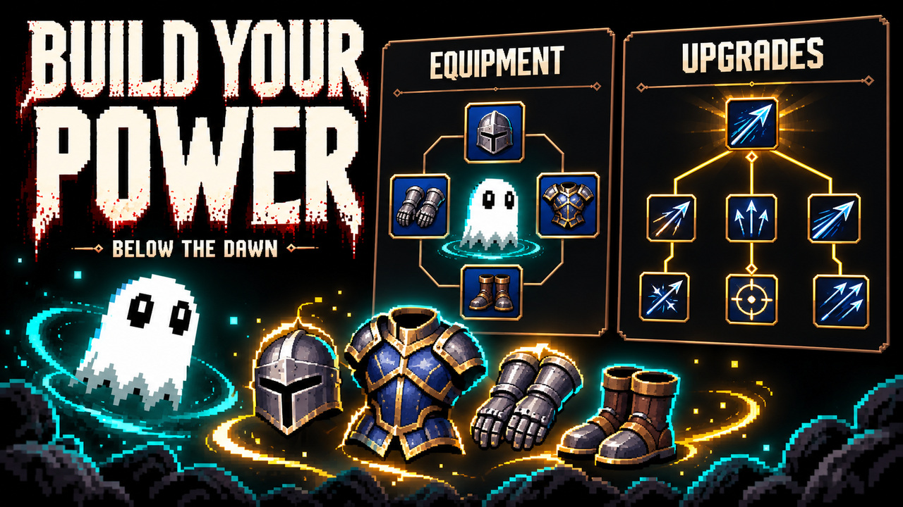

# Below the Dawn

**DarkTale · Solo Unity / C# project · In development**

A dark pixel-art roguelike about a little ghost climbing out of a cavern. Survive enemy waves, unlock gear slots and read a boss’s attack pattern before striking back.

## Gameplay trailer · 0:58

[][trailer]

[Watch the gameplay trailer][trailer]

## Combat modes

| Berserker duel | Skeleton battle | Wave survival |
| --- | --- | --- |
| [][berserk] | [][skeleton] | [][wave] |
| [Watch · 2:54][berserk] Read the cuts, find a safe zone and time a counterattack. | [Watch · 2:54][skeleton] Dodge a sweeping laser while reinforcements crowd the arena. | [Watch · 1:15][wave] Survive waves of enemies with a bow and active abilities. |

## Progression and trade

| Gear & progression | Moss the merchant |
| --- | --- |
| [][interface] | [][merchant] |
| [Watch · 0:57][interface] Unlock slots with cards and equip gear to change your build. | [Watch · 0:28][merchant] Browse equipment and abilities between fights. |

[Open the full video gallery][gallery]

[trailer]: https://asphodelwe.github.io/darktale-showcase/#watch-trailer
[berserk]: https://asphodelwe.github.io/darktale-showcase/#watch-berserk
[skeleton]: https://asphodelwe.github.io/darktale-showcase/#watch-skeleton
[wave]: https://asphodelwe.github.io/darktale-showcase/#watch-wave
[interface]: https://asphodelwe.github.io/darktale-showcase/#watch-interface
[merchant]: https://asphodelwe.github.io/darktale-showcase/#watch-merchant
[gallery]: https://asphodelwe.github.io/darktale-showcase/
