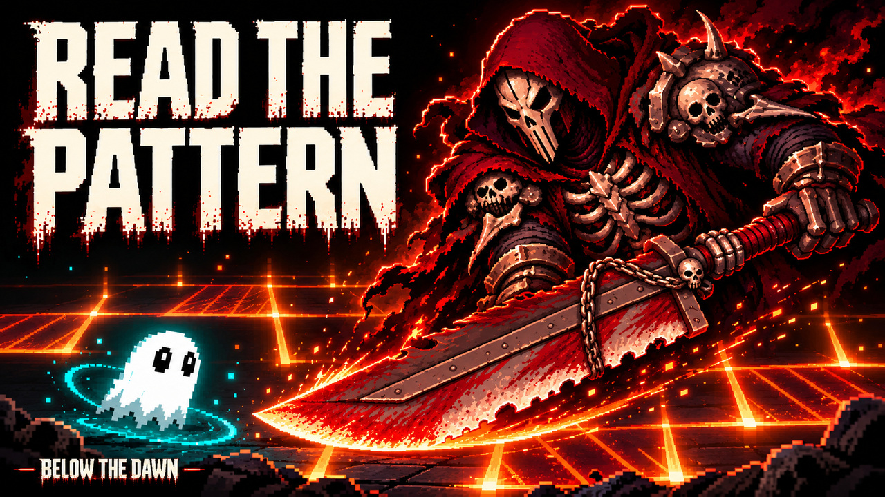
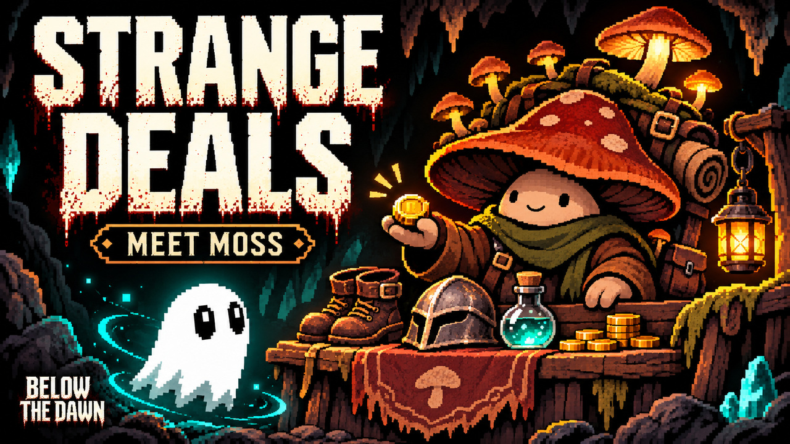

# Below the Dawn

**DarkTale · Solo Unity / C# project · In development**

A dark pixel-art roguelike about a little ghost climbing out of a cavern. Survive enemy waves, unlock gear slots and read a boss’s attack pattern before striking back.

## Gameplay

### Wave combat · 1:15

[][wave]

[Watch Wave combat][wave] · Keep moving through the cavern arena while using a bow and active abilities.

| Boss encounters | Progression and trade |
| --- | --- |
| [][berserk] | [][interface] |
| **[Berserker][berserk]** · 2:54 Read the cuts, find a safe zone and time a counterattack. | **[Gear & progression][interface]** · 0:57 Unlock slots with cards and equip gear to change your build. |
| [][skeleton] | [][merchant] |
| **[Skeleton][skeleton]** · 2:54 Dodge the sweeping laser while reinforcements crowd the arena. | **[Moss the merchant][merchant]** · 0:28 Browse equipment and abilities between fights. |

[Open the full video gallery][gallery]

[wave]: https://asphodelwe.github.io/darktale-showcase/#watch-wave
[berserk]: https://asphodelwe.github.io/darktale-showcase/#watch-berserk
[interface]: https://asphodelwe.github.io/darktale-showcase/#watch-interface
[skeleton]: https://asphodelwe.github.io/darktale-showcase/#watch-skeleton
[merchant]: https://asphodelwe.github.io/darktale-showcase/#watch-merchant
[gallery]: https://asphodelwe.github.io/darktale-showcase/
